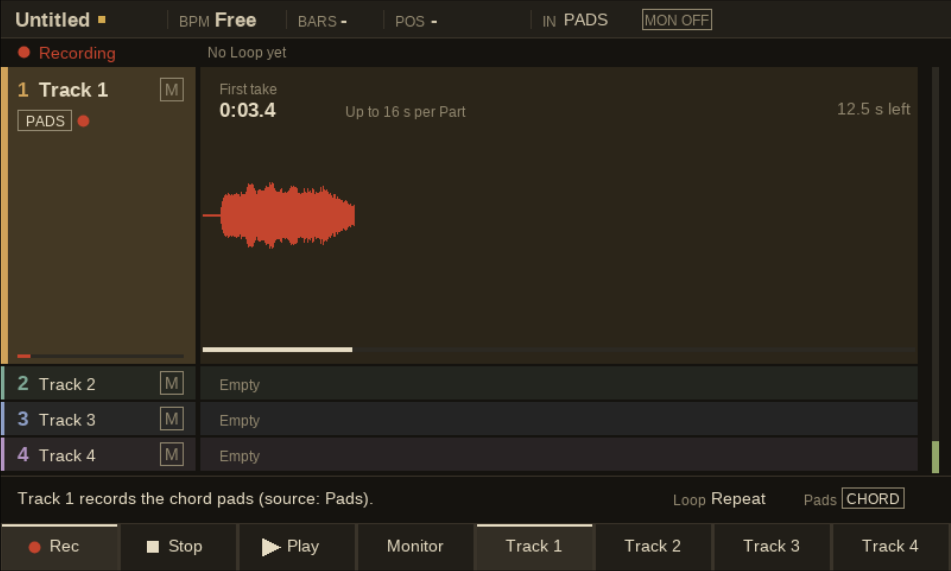
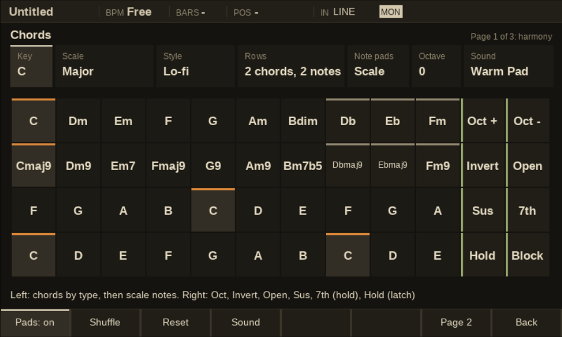
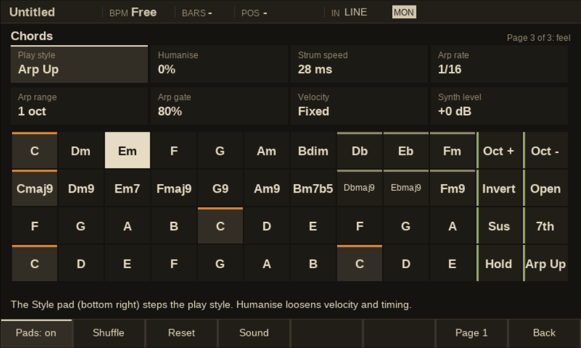
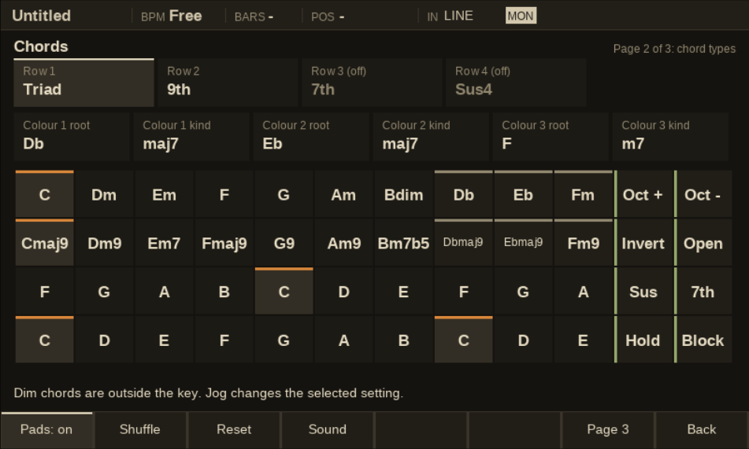
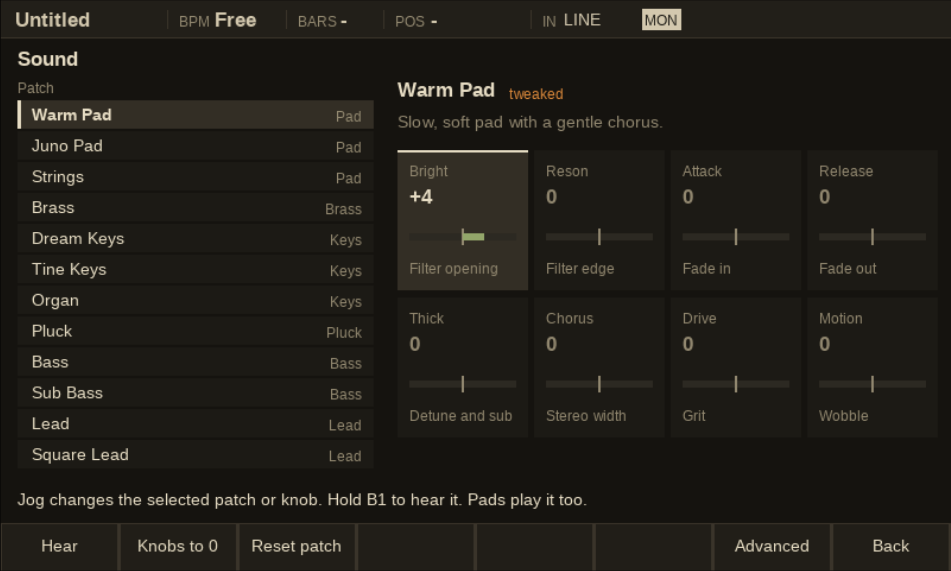

# Tape Tracker: a four-track recorder with chord pads and a synth for the Original Polyend Tracker

This is a fork of Polyend's open firmware ([`polyend/tracker-ce`](https://github.com/polyend/tracker-ce)) that turns the **Original Polyend Tracker** (Kinetis MK66, Cortex-M4F at 180 MHz) into a **four-track looping recorder** with a **chord and scale instrument** built on the 48 pads and a **vintage-style synth**. You play chords on the pads, record them one part at a time, then play a melody over them on the next track.

The stock Pattern, Song and Instrument editors are gone. The Tracker boots straight into the recorder. Everything it does is described below.



> **Status:** the first four-track recorder builds were tested on a real Original Tracker (recording, the home screen, waveform bitmaps). Builds since then (Copy and Clear, the removed stock screens, the mixer, the chord pads, the synth, the play styles and the sound controls) have so far only been run in the web emulator and in tests: expect rough edges, and tell me what you find on the device. Nothing has been measured for CPU load with the synth on a real Tracker yet. See [`docs/first-test-build.md`](docs/first-test-build.md) for what each build contains and what to check.

---

## The workflow

1. **Set up the pads.** Press **Note**. Pick a key, a scale and a style. The pads become chords and scale notes.
2. **Record the chords.** Press **Rec**. After a count-in, hold chord pads for the first take. The track's source is set to *Pads* for you, so what you play is what is recorded. Stop sets the loop length (how many bars).
3. **Play over it.** Pick Track 2, press **Rec**: it records one loop in time with the first. Play single notes on the scale pads, or more chords.
4. **Shape it.** Level, pan and tone per track on **Params**. Copy a Part to another track, clear one, undo a take, glitch a Part, trim it in the Part Editor.
5. **Keep it.** Save the project to the SD card, export WAV files.

Tempo is either **Free** (the first take sets the loop and the tempo is worked out from its length) or **Set** (takes land on a grid at the tempo you choose). Later Parts always record exactly one loop and are aligned automatically.

---

## Chord pads

The 48 pads (12 columns by 4 rows) are split into regions:

| Region | What it does |
|---|---|
| **Left ten columns, top rows** | **Chords.** Each row is one *chord type*: Triad, 6th, 7th, Maj7, 9th, Add9, Add4, Sus2, Sus4, 6/9, 7sus4 or Power. Columns 1 to 7 are the scale's seven chords; columns 8 to 10 are three *colour* chords from outside the key. |
| **Left ten columns, other rows** | **Notes.** The scale, rising left to right and upward. Modes: *Scale*, *Chord* (the notes of the chord you played last) or *Follow* (the scale, with the last chord's notes marked). |
| **Right two columns** | **Performance pads**, for the right hand. |



- **Theory built in.** 9 scales (Major, Minor, Harmonic and Melodic minor and the modes), 12 keys. The 7th and 9th follow the scale, so ii gives a m7 and V a dominant 7. Chords with notes outside the key (Maj7 on ii, for instance) are shown and lit dimmer, so you can see what leaves the key.
- **Styles.** Lo-fi, Pop, Jazz-ish, Synthwave and Soul set the row types and three colour chords. **Shuffle** re-rolls the colour chords. You can set every row type and every colour chord yourself on page 2 of the Chords screen.
- **Performance pads** (held while you play a chord): **Oct +**, **Oct -**, **Invert**, **Open** (spread voicing), **Sus**, **7th**. **Hold** latches the chord so it keeps sounding after you let go. The last pad is the **Style pad** and steps the play style.
- **Play styles:** Block, Strum down, Strum up, Arpeggio up, down, up-down and random. Strum speed, arpeggio rate (1/4 to 1/32, triplets), range (1 to 3 octaves) and gate are settings. While a loop plays, an arpeggio waits for the loop's grid, so recorded arpeggios sit in time.
- **Humanise** loosens velocity, timing and note length. **Velocity** can come from the pads.
- **Pad lights** show the tonic, the colour chords and the chord tones in steps of brightness, flash when a pad is played and fade, and pulse on the beat. (The Tracker's pad LEDs have brightness only, no colour.)





---

## Synth

Six voices built on [Plaits](https://github.com/pichenettes/eurorack) oscillators (Mutable Instruments, MIT) with a 24 dB low-pass filter, two envelopes, an LFO, drive and a stereo ensemble chorus. It plays into the pad bus, so it is recorded exactly like a pad sound.

Press **Instr** for the **Sound** screen: choose one of 12 patches (Warm Pad, Juno Pad, Strings, Brass, Dream Keys, Tine Keys, Organ, Pluck, Bass, Sub Bass, Lead, Square Lead), then tweak it with **eight knobs** (Bright, Reson, Attack, Release, Thick, Chorus, Drive, Motion). **Advanced** opens all 28 raw settings. Hold B1 to hear a patch. Your sound and chord settings are saved on the SD card.

Prefer samples? Set the chord sound to *Sample* and the chords play the sample on the pads, pitched.



---

## Everything else on the device

- **Four tracks**, always visible, each with its own colour, a waveform drawn as a bitmap, and a live waveform while recording. Parts up to 16 s.
- **Mixer** (Params): level, pan, tone, mute and solo for each track. Quick keys on the home screen: **Shift + Jog** is the selected track's level, **Left and Right** the synth level, **Shift + Left or Right** the output volume.
- **Part Editor**: trim, fades, grid and snap to zero crossings, offset, normalise.
- **Glitch** (Perform): stutter, jump, reverse, crush and more, held or latched per Part.
- **Lo-fi master**: tape saturation, glue, wow and flutter, bit crush. It is **opt in** (it starts bypassed).
- **Copy / Delete**: copy a Part to another track, clear a Part, clear all, undo.
- **Samples**: load WAV files from the SD card onto the pads (Sample Load), set tune, volume, start and end (Sample Play), resample the mix into a pad slot (Sample Rec).
- **Projects**: save, load, export WAV. Device settings and the firmware updater are on Config.

**Shortcuts.** Shift + Play is the click. B2 before the first take sets the tempo. Shift + B1 loop mode, Shift + B4 input and source, Shift + B5 to B8 mute tracks. The full list is in the emulator's Emulator settings overlay.

---

## Try it without a Tracker: the web emulator

[`prototype/emulator/dist/four-track-emulator.html`](prototype/emulator/dist/four-track-emulator.html): open it in a browser and click once. It runs **the same application code as the firmware**, compiled to WebAssembly, with the Tracker's real fonts, the pad layout and the synth. Keys: **N** Chords, **T** Sound, **1 to 8** the eight buttons, **[ ]** the jog, **R** Rec, **S** Stop, **Space** Play, **H** home, click the pads. Use headphones.

Rebuild it with `python3 prototype/emulator/build.py` (needs clang with the wasm target). Always build with `tools/build-all.sh <number>`: it builds the emulator, runs the tests and builds the firmware from the same sources with the same build id.

---

## Building and flashing

Prerequisites: the [GNU Arm Embedded Toolchain 10.3-2021.10](https://developer.arm.com/downloads/-/gnu-rm) on your `PATH` (or `TOOLCHAIN=/path/to/arm-none-eabi-`), `make`, `python3`, and clang with the wasm32 target for the emulator.

```bash
tools/build-all.sh 47      # tests + emulator + firmware, one build id
make original              # or just the Original Tracker firmware
tests/run.sh               # the host tests only
```

The firmware is written to `firmware/` as `PolyendTracker_FT<number>_full.ptf`.

**Flash it:** copy the `.ptf` to the `/Firmware/` folder on the Tracker's microSD card (name at most 31 characters, starting `PolyendTrac`), then **Config**, **Firmware**, choose the file and press **B1 Update**.

> **Keep a stock `.ptf` on the card.** The bootloader runs on a separate microcontroller and is never touched by this firmware, so a build that fails to boot can be recovered: put a known-good `.ptf` in `/Firmware/`, insert the card, power on, and press the recessed Reset pinhole on the bottom of the Tracker. **Never change the linker script's flash start address or anything in the bootloader area.**

---

## What is where

```text
core/ft/            The four-track application, screens, chord engine and synth glue (shared by the firmware and the emulator)
core/ft/dsp/        Track playback, lo-fi master, the synth and its patches (Plaits and stmlib are vendored in third_party/)
core/interface/fourTrack/   The Tracker-specific side: display, pads, audio nodes
prototype/emulator/ The web emulator
tests/              Host tests for the engine, the synth and the application (tests/run.sh)
docs/               Build notes, test checklists, design briefs and research
  first-test-build.md   what each firmware build contains, and what to check on the device
  design/               screen limits and the briefs for the design tool
  plan-synth-and-chords.md   the plan and status of the chord and synth work
wayfinder/          decisions and open questions (start with map.md)
firmware/           built firmware images
```

The original Polyend README (themes, `.ptfx` SDK, synth SDK links) is kept as [`docs/upstream-readme.md`](docs/upstream-readme.md). New here? Read [`HANDOVER.md`](HANDOVER.md), [`START-HERE.md`](START-HERE.md) and [`CONTEXT.md`](CONTEXT.md).

---

## Credits and licence

- Built on Polyend's open firmware, **Polyend Tracker Community Edition**. The platform code, audio engine and drivers are theirs; this fork replaces the application on top of them.
- **Plaits** oscillators, ensemble and overdrive, and **stmlib**, by Emilie Gillet (Mutable Instruments), MIT licence. The chord theory follows the author's [`chroma-chords`](https://github.com/warmsynths/chroma-chords).
- **Licence:** PolyForm Noncommercial 1.0.0 with Polyend's additional permissions; see [`LICENSE`](LICENSE). Making and selling **music** with the firmware is expressly permitted; selling the firmware or putting it in a competing product is not. Third-party parts: [`NOTICE.md`](NOTICE.md). The precompiled `synth/lib/*.a` libraries keep their own licence.
- **Provided as is.** This is an unofficial community firmware: no warranty, and **Polyend does not support it**. Flashing custom firmware is at your own risk, though the bootloader is separate and a stock `.ptf` on the card always recovers the device (above).
